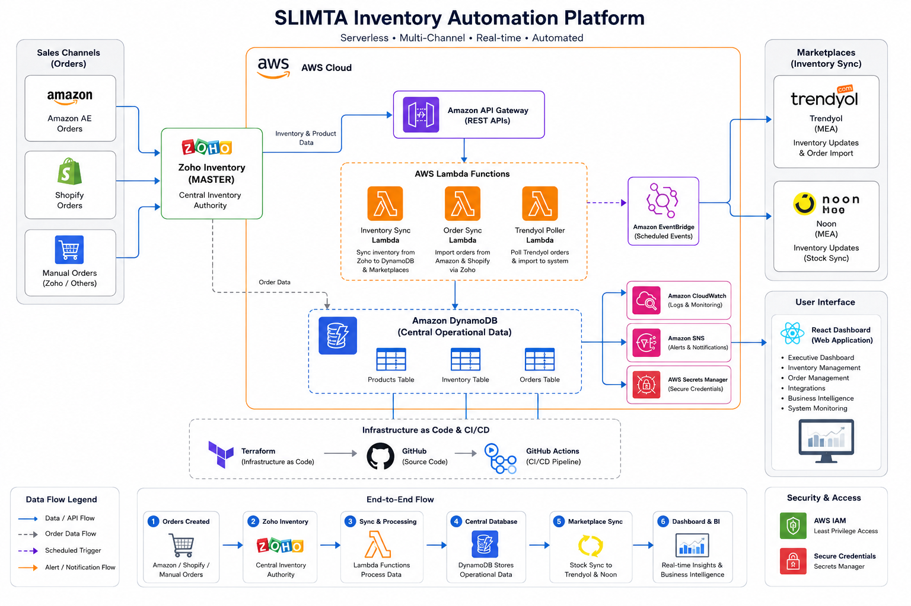
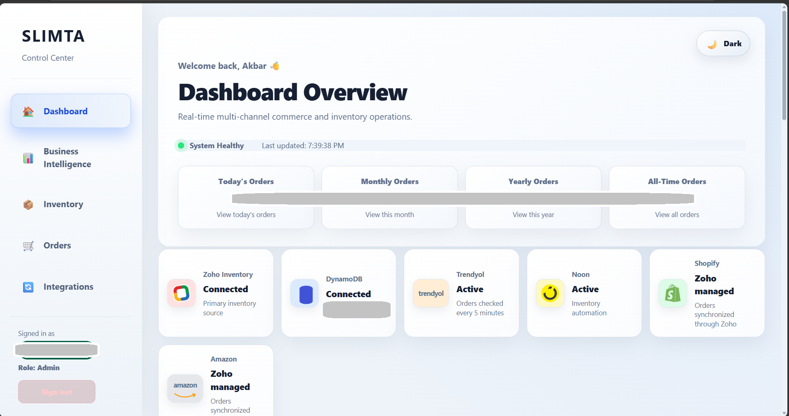
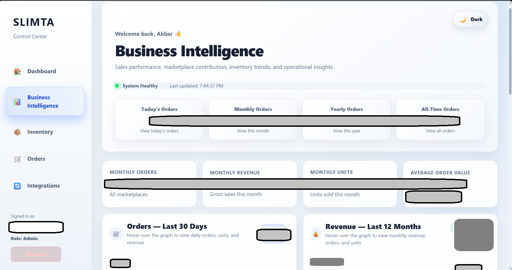
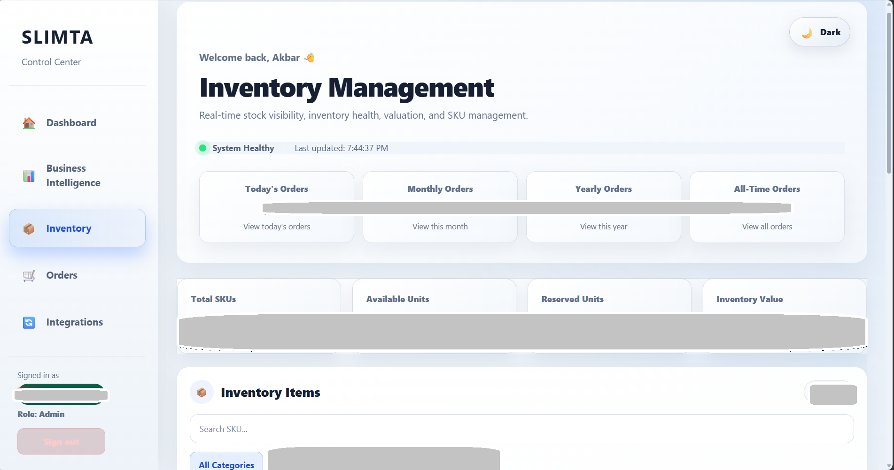
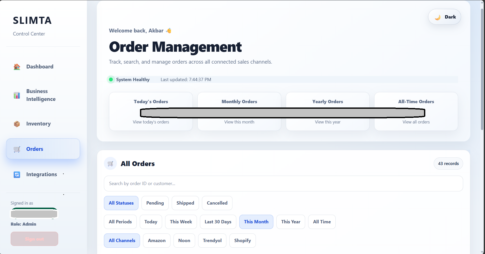
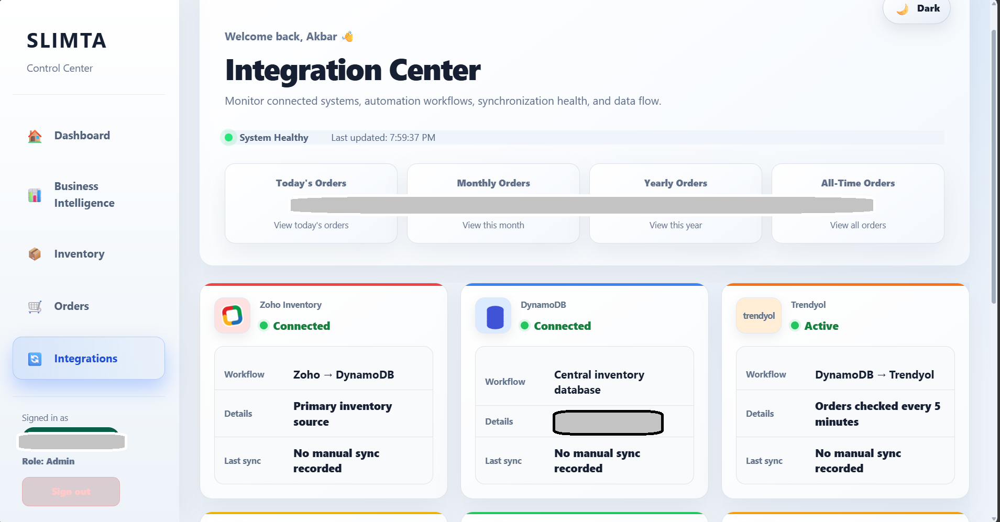

# SLIMTA Inventory Automation Platform

> An AWS serverless inventory and order automation platform supporting real multi-channel e-commerce operations.

## Project Overview

The SLIMTA Inventory Automation Platform is an AWS-based serverless application developed to centralize inventory visibility, automate supported marketplace synchronization workflows, consolidate order information, and provide operational monitoring through a React management dashboard.

Zoho Inventory serves as the primary inventory authority, while Amazon DynamoDB provides the operational data layer for AWS-based automation, reporting, and dashboard functionality.

---

## Business Problem

Managing inventory across multiple marketplaces introduces several operational challenges:

- Stock levels can become inconsistent between sales channels.
- Manual inventory updates consume time and introduce errors.
- Orders originate from different marketplaces and systems.
- Overselling becomes possible when stock changes are not propagated quickly.
- Operational information becomes fragmented across platforms.
- Troubleshooting integrations becomes difficult without centralized monitoring.
- Business owners lack a single view of orders, inventory, marketplace performance, and system health.

The objective was to replace these disconnected processes with a centralized, automated cloud platform.

[Read the detailed business problem](docs/business-problem.md)

---

## Solution

The platform uses a serverless AWS architecture with Zoho Inventory acting as the primary inventory source.

Inventory changes are synchronized into a central DynamoDB operational layer and propagated to supported marketplace integrations.

Orders from connected sales channels are consolidated into the operational platform, while the dashboard provides visibility into inventory, orders, marketplace performance, integrations, alerts, and business intelligence.

The architecture emphasizes:

- Automation
- Reliability
- Scalability
- Observability
- Fault recovery
- Maintainability
- Secure credential handling
- Infrastructure as Code

[Read the solution overview](docs/solution.md)

---

## Key Features

- Multi-channel inventory synchronization
- Automated order processing
- Centralized inventory visibility
- Marketplace API integrations
- Scheduled synchronization workflows
- Low-stock monitoring and alerts
- Retry mechanisms for integration failures
- Automatic dashboard alert expiry
- Duplicate order protection
- Inventory availability monitoring
- Business Intelligence analytics
- Marketplace performance reporting
- Operational system-health monitoring
- REST API backend
- Responsive React management dashboard
- Infrastructure as Code
- Automated CI/CD deployments

---

## Technology Stack

| Layer | Technologies |
| --- | --- |
| Cloud | AWS |
| Compute | AWS Lambda |
| API | Amazon API Gateway |
| Database | Amazon DynamoDB |
| Scheduling & Events | Amazon EventBridge |
| Notifications | Amazon SNS |
| Monitoring | Amazon CloudWatch |
| Security | AWS IAM, AWS Secrets Manager |
| Backend | Python |
| Frontend | React, JavaScript, Vite |
| Infrastructure as Code | Terraform |
| CI/CD | GitHub Actions |
| Integration | REST APIs |

---

## Marketplace & Business Integrations

The platform integrates operational workflows involving:

- Zoho Inventory
- Amazon
- Shopify
- Noon
- Trendyol

Integration responsibilities differ by platform rather than treating every marketplace identically.

Zoho Inventory acts as the primary inventory authority. DynamoDB provides the operational data layer used by the automation platform, while marketplace-specific workflows synchronize inventory and orders according to each integration model.

---

## High-Level Architecture

<p align="center">
  
</p>

> Production architecture overview showing inventory authority, AWS serverless processing, operational data, marketplace synchronization, monitoring, security, CI/CD, and the React management dashboard.

```text
                         ┌─────────────────────┐
                         │   Zoho Inventory    │
                         │ Inventory Authority │
                         └──────────┬──────────┘
                                    │
                                    ▼
                         ┌─────────────────────┐
                         │ AWS Automation Layer│
                         │ Lambda / Python     │
                         └──────────┬──────────┘
                                    │
                                    ▼
                         ┌─────────────────────┐
                         │ Amazon DynamoDB     │
                         │ Operational Data    │
                         └──────────┬──────────┘
                                    │
                    ┌───────────────┴───────────────┐
                    ▼                               ▼
             ┌─────────────┐                 ┌─────────────┐
             │   Trendyol  │                 │    Noon     │
             │ Integration │                 │ Integration │
             └─────────────┘                 └─────────────┘

       Amazon / Shopify Orders
                 │
                 ▼
        Zoho-managed workflow
                 │
                 ▼
        Operational Data Layer
                 │
                 ▼
        React Management Dashboard
```

[Architecture documentation](docs/architecture.md)

---

## Management Dashboard

The platform includes a modern React-based management dashboard that provides operational visibility into inventory, orders, integrations, and business performance.

### Executive Dashboard

- Order summary
- Revenue overview
- Monthly and yearly performance
- Integration status
- Recent orders
- Marketplace statistics

### Inventory Management

- SKU-level inventory visibility
- Available and reserved stock
- Inventory valuation
- Product categories
- Stock health indicators
- Low-stock monitoring
- Out-of-stock visibility

### Order Management

- Multi-channel orders
- Order status tracking
- Marketplace filters
- Time-period filters
- Search
- Pagination
- Order detail visibility

### Business Intelligence

- Revenue analytics
- Order trends
- Units sold
- Average Order Value
- Marketplace contribution
- Top-selling SKUs
- Performance comparisons
- Rolling period analytics

### Integration Center

- Zoho Inventory
- DynamoDB
- Amazon
- Shopify
- Noon
- Trendyol
- Synchronization workflows
- Integration health

---

## Platform Preview

### Dashboard Overview

Central operational view of orders, connected systems, inventory workflows, and platform health.

<p align="center">
  
</p>

---

### Business Intelligence

Interactive analytics for revenue, orders, units sold, marketplace contribution, SKU performance, and period comparisons.

<p align="center">
  
</p>

---

### Inventory Management

SKU-level inventory visibility with available stock, reserved quantities, inventory valuation, product categories, and stock-health monitoring.

<p align="center">
  
</p>

---

### Order Management

Centralized order visibility with marketplace, status, and time-period filtering across connected sales channels.

<p align="center">
  
</p>

---

### Integration Center

Operational visibility into Zoho Inventory, DynamoDB, Amazon, Shopify, Noon, and Trendyol workflows and synchronization state.

<p align="center">
  
</p>

> **Privacy Notice:** Sensitive production data, including financial figures, inventory quantities, operational metrics, and account information, has been redacted from dashboard screenshots.

---

## Reliability Engineering

Marketplace and business-system integrations may experience temporary failures due to API rate limits, authentication issues, network interruptions, or unexpected responses.

The platform includes reliability and monitoring mechanisms to improve operational visibility and support troubleshooting.

### Reliability Features

- API response validation and error handling
- Retry handling for supported integration failures
- Duplicate order protection
- EventBridge-based scheduled synchronization
- CloudWatch logging for backend troubleshooting
- SNS notifications for low-stock conditions
- Integration-health monitoring through the management dashboard

### Dashboard Alerts

The Business Intelligence dashboard provides automated alerts for configured operational conditions, including:

- Marketplace integration errors
- API rate-limiting events, including HTTP 429 responses
- Defined SKU and order-processing exceptions

Dashboard alerts can expire automatically after a configured duration without manual dismissal.

**Note:** Automatic alert expiry does not necessarily indicate that the underlying issue has been resolved. Persistent integration failures may require manual investigation and corrective action.

### Troubleshooting and Recovery

CloudWatch logs and dashboard alerts help identify integration failures, API errors, and inventory synchronization issues.

Supported retry mechanisms can handle certain temporary failures. Persistent errors, such as repeated API rate limiting or authentication problems, may require manual intervention.

[Monitoring documentation](docs/monitoring.md)

---


## Infrastructure & CI/CD

AWS infrastructure is managed using Terraform, while backend and frontend deployments are automated through two GitHub Actions workflows.

### Backend CI/CD — AWS Lambda

The backend pipeline runs when Lambda code, tests, or workflow configuration changes.

**Continuous Integration:**
- Python 3.12 environment setup
- Dependency installation
- Python compilation checks
- Black formatting validation
- Ruff linting
- MyPy static type checking
- Pytest unit tests with coverage reporting

**Continuous Deployment:**
- Deployment runs only on pushes to the `main` branch after successful validation.
- Packages Python dependencies and Lambda source files into a ZIP artifact.
- Deploys four AWS Lambda functions using the AWS CLI.

### Frontend CI/CD — React Dashboard

The frontend deployment workflow runs when frontend files change on the `main` branch.

- Installs Node.js dependencies using `npm ci`.
- Builds the React application for production.
- Uploads the production build to Amazon S3.
- Invalidates the CloudFront cache to publish updated dashboard assets.

### Deployment Workflow

**Backend:**

```text
Code Push / Pull Request
         |
         v
Python Compilation
         |
         v
Black / Ruff / MyPy
         |
         v
Pytest + Coverage
         |
         v
Push to main?
         |
         +-- No --> Validation Only
         |
         +-- Yes --> Package Lambda ZIP
                          |
                          v
                    Deploy 4 Lambdas
```

**Frontend:**

```text
Frontend Push to main
         |
         v
Install Dependencies
         |
         v
Build React Application
         |
         v
Upload Build to S3
         |
         v
CloudFront Cache Invalidation
```

[Deployment documentation](https://github.com/Akbar324/slimta-inventory-showcase/blob/main/docs/deployment.md)

---

## Engineering Practices

The project demonstrates cloud and DevOps practices including:

- Infrastructure as Code using Terraform
- AWS serverless architecture
- Automated code-quality checks
- Unit testing and coverage reporting
- API integration testing
- Deployment gated by successful backend tests
- Separate backend and frontend CI/CD workflows
- Git version control
- AWS IAM and Secrets Manager
- CloudWatch monitoring and troubleshooting
- Environment-based configuration
- Separation of production and public portfolio repositories

---

## Repository Structure

```text
slimta-inventory-showcase/
├── README.md
├── architecture/
│   ├── aws/
│   ├── diagrams/
│   └── final/
│       └── slimta-aws-architecture.png
├── assets/
│   ├── banners/
│   ├── icons/
│   └── logo/
├── docs/
│   ├── architecture.md
│   ├── business-problem.md
│   ├── deployment.md
│   ├── monitoring.md
│   ├── roadmap.md
│   └── solution.md
└── screenshots/
    ├── analytics/
    │   └── business-intelligence.png
    ├── dashboard/
    │   └── dashboard-overview.png
    ├── integrations/
    │   └── integration-center.png
    ├── inventory/
    │   └── inventory-management.png
    └── orders/
        └── order-management.png
```

---

## Project Outcomes

The platform demonstrates how cloud-native automation can simplify multi-channel e-commerce operations through:

- Centralized inventory visibility
- Automated inventory synchronization
- Automated order consolidation
- Marketplace integrations
- Business Intelligence reporting
- Centralized operational dashboards
- Faster identification of synchronization issues
- Persistent operational alerts with deduplication, resolution, and expiration support
- Repeatable infrastructure deployment
- Automated application deployment
- Reduced dependency on manual operational processes

---

## Roadmap

Potential future enhancements include:

- AI-assisted demand forecasting
- Reorder recommendations
- Supplier management
- Purchase-order automation
- Warehouse analytics
- Advanced anomaly detection
- Mobile operational views
- Additional marketplace integrations

[Project Roadmap](docs/roadmap.md)

---

## Security & Privacy

This public repository intentionally excludes:

- Production source code
- API credentials
- Access tokens
- AWS account identifiers
- Environment variables
- Customer information
- Marketplace seller identifiers
- Terraform state
- Authentication secrets
- Production API endpoints
- Business-sensitive implementation details

Production secrets are managed separately from source code, and the production implementation remains private.

---

## About the Engineer

**Akbar Hussain**

**AWS Certified Solutions Architect – Associate (SAA-C03)**

Telecom engineer with 14+ years of experience in network operations, integration, and technical troubleshooting, transitioning into AWS Cloud and DevOps engineering.

Developing practical skills in AWS serverless architecture, infrastructure automation, CI/CD, monitoring, and cloud operations through hands-on projects.

**Technical Focus:** AWS | Terraform | Linux | GitHub Actions | CI/CD | Python Fundamentals | CloudWatch

**GitHub:** https://github.com/Akbar324

**LinkedIn:** https://www.linkedin.com/in/akbar-hussain-30827144/

---

## Disclaimer

This repository is a technical showcase and architectural case study of a privately operated production platform.

Implementation details have intentionally been simplified or omitted to protect production systems, credentials, customer data, infrastructure information, and business-sensitive logic.