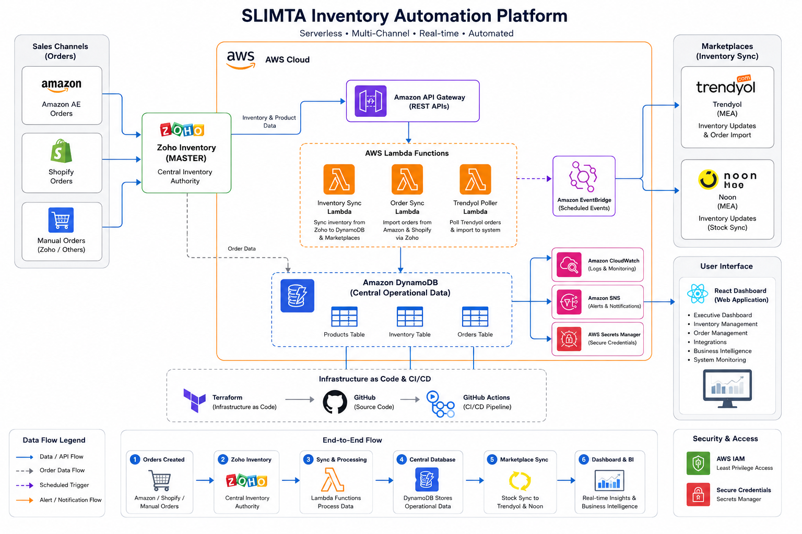

# Architecture

The SLIMTA Inventory Automation Platform is an AWS serverless application designed to automate inventory synchronization, order processing, marketplace integrations, and operational monitoring for a multi-channel e-commerce business.

Zoho Inventory serves as the primary inventory authority, while AWS provides the automation, operational data storage, API backend, and management dashboard infrastructure.

## Architecture Principles

The platform follows these principles:

- Centralized inventory authority
- Serverless compute and managed AWS services
- Scheduled and API-driven automation
- Separation of marketplace integration workflows
- IAM-based access control and secure credential management
- Infrastructure as Code using Terraform
- Automated CI/CD deployments
- Centralized logging and operational monitoring

## High-Level Architecture

The platform consists of five main layers:

1. **Business Systems:** Zoho Inventory and connected e-commerce marketplaces.
2. **Automation Layer:** AWS Lambda functions for inventory synchronization, order processing, and external API integrations.
3. **Operational Data Layer:** Amazon DynamoDB for products, inventory, and orders.
4. **API Layer:** Amazon API Gateway for communication between the dashboard and backend.
5. **Presentation Layer:** React dashboard hosted through Amazon S3 and CloudFront.

## Inventory Synchronization Flow

Zoho Inventory acts as the primary inventory source.

The inventory synchronization workflow follows this general process:

```text
Zoho Inventory
      |
      v
Scheduled AWS Lambda
      |
      v
Retrieve Inventory Data
      |
      v
Update Amazon DynamoDB
      |
      v
Marketplace Integration Workflows
      |
      +----> Trendyol
      |
      +----> Noon
```

Marketplace synchronization depends on each platform's supported APIs and integration requirements.

DynamoDB provides an operational data layer for automation and dashboard access, while Zoho remains the primary inventory authority.

## Order Processing Flow

Orders originate from connected e-commerce platforms.

Depending on the integration, orders are received through API requests, webhooks, or scheduled polling.

```text
E-commerce Marketplace
         |
         v
API / Webhook / Scheduled Polling
         |
         v
AWS Lambda
         |
         v
Order Validation and Processing
         |
         +----> Zoho Sales Order Workflow
         |
         +----> DynamoDB Operational Records
         |
         v
React Management Dashboard
```

The platform includes duplicate order protection, error handling, and operational logging.

Integration behavior varies between marketplaces.

## AWS Services

| AWS Service | Responsibility |
|---|---|
| AWS Lambda | Serverless order processing and inventory automation |
| Amazon API Gateway | Backend API endpoints |
| Amazon DynamoDB | Operational products, inventory, and order data |
| Amazon EventBridge | Scheduled synchronization and polling |
| Amazon SNS | Low-stock notifications |
| Amazon CloudWatch | Logs, monitoring, and troubleshooting |
| AWS IAM | Service permissions and access control |
| AWS Secrets Manager | Secure integration credential storage and retrieval |
| Amazon S3 | Frontend build hosting |
| Amazon CloudFront | Dashboard content delivery |

## Management Dashboard

The platform includes a React-based dashboard built with JavaScript and Vite.

The frontend is deployed to Amazon S3 and delivered through CloudFront.

The dashboard communicates with the AWS backend through API Gateway.

```text
User Browser
     |
     v
Amazon CloudFront
     |
     v
React Dashboard (S3)
     |
     v
Amazon API Gateway
     |
     v
AWS Lambda
     |
     v
Amazon DynamoDB
```

The dashboard provides operational visibility into:

- Inventory and stock health
- Orders and marketplace activity
- Integration status
- Business Intelligence analytics
- Operational alerts and monitoring

## Monitoring and Reliability

Amazon CloudWatch provides Lambda execution logs, error visibility, and operational troubleshooting.

Amazon SNS supports low-stock notifications.

The dashboard also displays integration-health information and configured operational alerts.

Reliability mechanisms include:

- API error handling and response validation
- Retry handling for supported temporary failures
- Duplicate order protection
- Scheduled synchronization
- CloudWatch logging
- Dashboard alert expiry after a configured duration

Persistent integration failures may require manual investigation.

## Security

The platform uses AWS IAM to control access to AWS services.

AWS Secrets Manager is used for secure storage and retrieval of supported integration credentials.

Sensitive production information is excluded from the public showcase repository, including:

- API credentials and access tokens
- Customer information
- AWS account identifiers
- Production API endpoints
- Terraform state files
- Business-sensitive configuration

The production implementation is maintained separately from this public technical case study.

## Infrastructure as Code

Terraform is used to define and manage AWS infrastructure.

Infrastructure as Code provides:

- Version-controlled configuration
- Repeatable infrastructure provisioning
- Consistent resource definitions
- Reviewable infrastructure changes

## CI/CD Architecture

Two GitHub Actions workflows automate backend and frontend deployment.

**Backend pipeline:**

```text
Code Push / Pull Request
         |
         v
Python Compilation
         |
         v
Black / Ruff / MyPy
         |
         v
Pytest with Coverage
         |
         v
Push to main?
         |
         +-- No --> Validation Only
         |
         +-- Yes --> Package Lambda ZIP
                          |
                          v
                    Deploy 4 Lambdas
```

**Frontend pipeline:**

```text
Frontend Push to main
         |
         v
Install Dependencies
         |
         v
Build React Application
         |
         v
Upload to Amazon S3
         |
         v
CloudFront Cache Invalidation
```

Backend deployments are gated by successful automated tests.

## Architecture Diagram

See the architecture diagram:



## Architecture Notes

This document describes the platform at a high level for technical portfolio purposes.

Certain implementation details have been simplified or omitted to protect production infrastructure, credentials, customer information, and business-sensitive logic.
